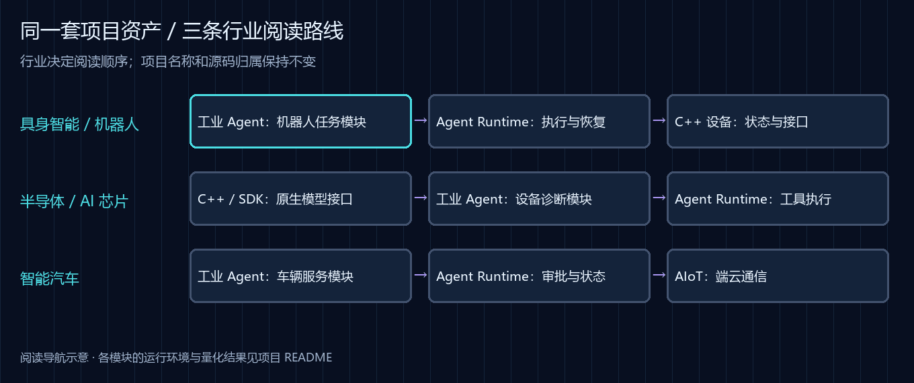

# 岳玉婷 · Yuting Yue

### AI 应用与任务平台研发｜Python / C++｜通信与智能设备

UCL 通信工程硕士 · 北京交通大学通信工程本科  
中国电信物联网研发 · 生产系统 AI 应用开发经历

围绕 **AI 应用工程化、可靠任务执行、设备与模型接口**开展项目开发：将自然语言目标转为结构化工具调用，连接知识库、设备状态与业务服务，完成任务执行、进度反馈、异常处理和结果持久化。

我的技术优势是把通信与设备背景延伸到软件研发：既关注模型如何理解任务、调用工具，也关注任务怎样执行、接口怎样连接，以及异常后如何保留可信结果。

**技术主线：业务应用 → 执行内核 → 设备与模型接口 → 可核查结果。**

---

## 按行业阅读路线（项目逻辑、关联与证据链）

### 先了解结构：4 个核心项目，3 个业务场景

**核心项目 1 包含三个业务场景，核心项目 2—4 分别提供执行、设备与模型接口、端云通信能力。** 下文始终使用相同项目名称，业务场景不另算项目。

| 编号 | 固定项目名称 | 项目职责 | 主要技术 |
|---|---|---|---|
| **核心项目 1** | **[工业 Agent](https://github.com/KristenYue/telecom-network-incident-agent)** | AI 业务应用：模型调用、知识检索、工具编排与结果生成；包含下述三个业务场景 | Python、LLM / RAG、FastAPI、设备 Adapter |
| **核心项目 2** | **[Agent Runtime](https://github.com/KristenYue/agent-runtime-quality-platform)** | 通用执行内核：工具注册、权限与预算、审批、Checkpoint、幂等与恢复 | PostgreSQL、Lease / Heartbeat / Fencing、Trace |
| **核心项目 3** | **[C++ 设备与推理 SDK](https://github.com/KristenYue/edge-device-verification-lab)** | 设备状态与通信接口，以及 Python 调用 C++ 原生模型 | C++17、TCP、RAII、有界并发、pybind11、ONNX Runtime |
| **核心项目 4** | **[AIoT 端云系统](https://github.com/KristenYue/smart-supermarket-shelf)** | 设备感知、遥测传输、离线恢复、配置管理与云端查询 | C++、MQTT/TLS、AWS IoT、Java API |

**三个业务场景都位于核心项目 1「工业 Agent」中：**

1. **机器人任务**：查询工作站状态、执行巡检、反馈进度与取消任务。
2. **工业设备诊断**：读取设备观测、检索知识、生成带来源的诊断。
3. **车辆服务**：解释车辆信号，审批后调用模拟服务，保存执行结果。

项目阅读导航示意 · [静态版本](assets/industry-routes.png)

### 行业一：具身智能 / 机器人

**对应研发方向：机器人 AI 应用、任务平台、应用后端、设备技能接入。**

| 阅读顺序 | 看哪个项目、哪个模块 | 对应能力与证据 |
|---|---|---|
| **① 看业务场景 1** | **[核心项目 1：工业 Agent → 机器人任务](https://github.com/KristenYue/telecom-network-incident-agent/blob/main/docs/ROBOT_DELIVERY.md)** | 模型选择工具、技能前置状态、ROS 2 Service / Action、进度反馈与取消 |
| **② 看共用执行机制** | **[核心项目 2：Agent Runtime](https://github.com/KristenYue/agent-runtime-quality-platform)** | 执行预算、工具契约、Checkpoint、幂等与恢复边界 |
| **③ 看设备软件基础** | **[核心项目 3：C++ 设备与推理 SDK → 设备运行时](https://github.com/KristenYue/edge-device-verification-lab)** | 状态守卫、通信接口、超时处理与有界资源 |

**这条证据链说明：我能将 AI 任务接到设备技能接口，并处理执行过程中的状态、进度和异常。**

实际结果：真实模型完成 **3 次决策、2 次工具调用**的逻辑巡检；独立 ROS 2 验收完成 **3/3 点巡检**，另一次在 **1/3 点**请求取消并收敛为 `canceled`。

[模型轨迹](https://github.com/KristenYue/telecom-network-incident-agent/blob/main/docs/evidence/robot-live.json) · [ROS 2 云端验收](https://github.com/KristenYue/telecom-network-incident-agent/actions/runs/44509829892)

### 行业二：半导体 / AI 芯片

**对应研发方向：AI 应用、模型 SDK、研发工具软件、设备应用软件。**

| 阅读顺序 | 看哪个项目、哪个模块 | 对应能力与证据 |
|---|---|---|
| **① 看原生模型接口** | **[核心项目 3：C++ 设备与推理 SDK → 推理 SDK](https://github.com/KristenYue/edge-device-verification-lab/tree/main/inference_sdk)** | Tensor 契约、内存所有权、GIL、异常转换、数值对齐与 Wheel 交付 |
| **② 看业务场景 2** | **[核心项目 1：工业 Agent → 工业设备诊断](https://github.com/KristenYue/telecom-network-incident-agent)** | C++ 设备观测、原生知识检索、模型工具调用与诊断引用 |
| **③ 看共用执行机制** | **[核心项目 2：Agent Runtime](https://github.com/KristenYue/agent-runtime-quality-platform)** | 多步骤工具执行、预算、上下文与结果持久化 |

**这条证据链说明：我能开发跨语言模型接口，并将模型与设备能力接入实际可运行的软件应用。**

实际结果：BGE 输出 **3×512**，C++ SDK 与 Python ORT 最大绝对误差 **1.53×10⁻⁷**；Windows / Ubuntu 安装执行通过；真实模型经 **2 次工具调用**完成设备观测与原生知识检索。

[数值与延迟记录](https://github.com/KristenYue/edge-device-verification-lab/blob/main/inference_sdk/benchmarks/windows-bge.json) · [联合应用轨迹](https://github.com/KristenYue/telecom-network-incident-agent/blob/main/docs/evidence/native-llm-live.json)

### 行业三：智能汽车

**对应研发方向：车载 Agent 应用、智能终端服务、设备与云端平台。**

| 阅读顺序 | 看哪个项目、哪个模块 | 对应能力与证据 |
|---|---|---|
| **① 看业务场景 3** | **[核心项目 1：工业 Agent → 车辆服务](https://github.com/KristenYue/telecom-network-incident-agent/blob/main/docs/VEHICLE_ADAPTER.md)** | 信号解释、知识查询、审批、DBC 子集解码与虚拟 CAN |
| **② 看共用执行机制** | **[核心项目 2：Agent Runtime](https://github.com/KristenYue/agent-runtime-quality-platform)** | 写操作确认、上下文恢复、工具账本与执行记录 |
| **③ 看端云通信基础** | **[核心项目 4：AIoT 端云系统](https://github.com/KristenYue/smart-supermarket-shelf)** | 消息身份、离线缓存、重连、配置版本与遥测一致性 |

**这条证据链说明：我能围绕设备状态开发 AI 服务，并处理控制授权、数据新鲜度和端云通信中的一致性问题。**

实际结果：真实模型完成胎压解释与模拟空调审批执行；Linux `vcan0` 实际收发并解码信号。独立 AIoT 合成实验处理 **50,000 条遥测**，正常、重复、乱序和冲突计数完整闭合。

[车辆模型轨迹](https://github.com/KristenYue/telecom-network-incident-agent/blob/main/docs/evidence/vehicle-live.json) · [虚拟 CAN 验收](https://github.com/KristenYue/telecom-network-incident-agent/actions/runs/44505903871) · [IoT 实验](https://github.com/KristenYue/smart-supermarket-shelf/blob/main/iot-test-harness/docs/TEST_REPORT.md)

行业路线用于核查业务与支撑能力，不表示每个场景都已串联四个项目。机器人真实模型与 ROS 2 分别验收；设备为软件仿真，车辆采用合成服务与虚拟 CAN，原生推理使用 CPU。具体集成关系与运行范围见对应仓库。

---

## 核心研发成果

### 01 · AI 应用：从模型决策到设备任务

**[工业 Agent →](https://github.com/KristenYue/telecom-network-incident-agent)**

将模型接口、知识检索与设备能力封装成完整业务闭环：

- **机器人任务**：查询工作站状态、提交巡检技能、保存逐点反馈，支持取消与最终结果查询。
- **工业设备诊断**：读取 C++ 设备快照，调用原生 ONNX 知识工具，生成带文档身份与版本的诊断。
- **车辆服务**：解释胎压观测，检索项目知识；写操作进入显式审批后执行，保存命令与状态。
- **执行边界**：工具白名单、Pydantic 参数契约、前置状态检查、调用预算与有限重试；未知副作用不盲目重放。

| 已运行链路 | 实际结果 | 核查入口 |
|---|---|---|
| 真实模型 + 机器人逻辑工作站 | **3 次模型决策、2 次工具调用**，完成三点巡检并保存报告 | [模型轨迹](https://github.com/KristenYue/telecom-network-incident-agent/blob/main/docs/evidence/robot-live.json) |
| 规则 Planner + Linux ROS 2 + Runtime | **3/3 点巡检完成**；另一次在 **1/3 点**请求取消，终态为 `canceled` | [云端验收](https://github.com/KristenYue/telecom-network-incident-agent/actions/runs/44509829892) |
| 真实模型 + C++ 设备 + 原生知识检索 | **2 次工具调用**后完成诊断，检索后端明确标记为 `native_onnx` | [联合轨迹](https://github.com/KristenYue/telecom-network-incident-agent/blob/main/docs/evidence/native-llm-live.json) |
| Linux SocketCAN / vcan | 实际虚拟总线收发，并按项目 DBC 解出左前轮 **190 kPa** | [云端验收](https://github.com/KristenYue/telecom-network-incident-agent/actions/runs/44505903871) |

机器人真实模型与 ROS 2 为两组独立验收；车辆采用合成服务与虚拟总线。各结果保留对应执行环境。

### 02 · 任务平台：执行权、持久化与故障恢复

**[Agent Runtime →](https://github.com/KristenYue/agent-runtime-quality-platform)**

实现与模型供应商解耦的执行内核，业务侧注入 Planner 与工具，内核统一管理动作、预算、审批、观测、Checkpoint 与 Trace。

| 工程难点 | 实现机制 |
|---|---|
| 模型动作怎样成为受控调用 | Planner Protocol、显式工具注册、参数校验、权限与预算 |
| 中断后怎样复用已完成工作 | Checkpoint、工具结果账本、幂等身份与重放判断 |
| 旧 Worker 恢复后怎样阻止陈旧写入 | Lease / Heartbeat 判断执行权，单调 Fencing Token 约束提交 |
| 消息重复投递怎样处理 | 业务部署使用 Redis Streams Pending / 回收，结合持久化状态与幂等结果 |
| 危险动作怎样获得确认 | 保存待审批上下文，显式批准后恢复执行 |

**冻结合成契约验收：180/180 功能任务；70/70 故障处置，其中 68 次恢复、2 次按预期失败关闭；60 组重复提交的额外最终写入为 0。**

[逐项原始报告](https://github.com/KristenYue/agent-runtime-quality-platform/blob/main/data/evaluation/acceptance_v1/report.json) · [PostgreSQL / Redis 真实服务验收](https://github.com/KristenYue/telecom-network-incident-agent/actions/runs/44509829892)

本地契约实验与真实服务验收分别记录，避免将单机结果外推为分布式生产容量。

### 03 · C++ 工程：设备运行时与原生模型接口

**[C++ 设备与推理 SDK →](https://github.com/KristenYue/edge-device-verification-lab)**

**设备运行时**

- C++17 状态机与状态守卫，安全联锁独立于上层模型执行。
- move-only Socket RAII 明确线程、队列和 Worker 之间的资源所有权。
- 有界 Worker、连接队列、请求缓存与排队期限，避免无上限积压。
- 同一互斥边界内完成缓存检查、命令执行与响应入账，约束重复动作。

**原生推理 SDK**

- pybind11 封装 ONNX Runtime Session，校验输入名、dtype、rank、shape 与连续内存。
- Run 期间保留输入所有者，只在原生执行范围释放 GIL。
- 输出交由 Python 独立持有，避免 Session 销毁后出现悬空引用。
- Windows / Ubuntu Wheel 构建与干净环境安装，验证运行库随包交付。

| 结果 | 口径与证据 |
|---|---|
| **4,200/4,200 设备请求成功** | Windows 回环对照，4 Worker、32 队列槽；[完整数据](https://github.com/KristenYue/edge-device-verification-lab/blob/main/benchmarks/windows-baseline-comparison.json) |
| **排队过期返回 `QUEUE_TIMEOUT`** | 在进入设备核心前拒绝过期请求；[实测响应](https://github.com/KristenYue/edge-device-verification-lab/blob/main/benchmarks/windows-queue-deadline.json) |
| **BGE 输出 3×512，最大绝对误差 1.53×10⁻⁷** | C++ SDK 与 Python ORT 数值对齐；[原始数据](https://github.com/KristenYue/edge-device-verification-lab/blob/main/inference_sdk/benchmarks/windows-bge.json) |
| **Ubuntu 原生包独立安装执行通过** | 编译、参考计算图与干净环境验证；[云端记录](https://github.com/KristenYue/edge-device-verification-lab/actions/runs/44506857643) |

设备吞吐对照与 BGE 原生接口均未获得提速；成果集中于**资源有界、跨语言契约、生命周期安全与业务集成**，保留完整对照数据。

### 04 · 端云通信：身份、离线策略与数据一致性

**[AIoT 端云系统 →](https://github.com/KristenYue/smart-supermarket-shelf)**

双节点分别完成环境与库存感知，经 MQTT/TLS 接入云端，通过 Java 查询 API 为应用和 Agent 提供遥测。

- **消息身份**：`deviceID:bootId:sequence` 区分设备、重启会话与序列。
- **离线策略**：固定容量 Outbox、满队列淘汰计数、指数退避与恢复补发。
- **配置管理**：单调版本、完整参数校验、原子应用与结果回执。
- **数据消费**：重复、乱序和同身份载荷冲突分别分类；旧遥测不作为当前状态。

**50,000 条合成遥测：48,512 条正常入库，1,012 条重复、13 条乱序、463 条身份冲突被分类拦截，计数完整闭合。**

[实验报告](https://github.com/KristenYue/smart-supermarket-shelf/blob/main/iot-test-harness/docs/TEST_REPORT.md) · [遥测协议](https://github.com/KristenYue/smart-supermarket-shelf/blob/main/docs/TELEMETRY_V2.md)

---

## AI 方法与通信专业基础

| 项目 | 关键方法 | 结果或交付 |
|---|---|---|
| **[中文文本分析与知识研判 Agent](https://github.com/KristenYue/public-opinion-agent-eval)** | LangGraph、Hybrid RAG、事件感知 Reviewer、选择性自动处理与人工回写 | 同一冻结集 6 个未见事件、339 条评论，纯自动 Accuracy **31.27% → 56.05%，提升 24.78 个百分点** |
| **[中文情感分析本科毕设](https://github.com/KristenYue/chinese-sentiment-analysis-thesis)** | 中文预处理、TF-IDF、XGBoost、模型重训与 FastAPI 推理 | 原毕设 143 条随机测试集，重训 Accuracy **90.91%**、Macro-F1 **88.56%**；与跨事件实验分别报告 |
| **[自由空间光通信编码与交织仿真](https://github.com/KristenYue/fso-coding-interleaving-simulator)** | Gamma–Gamma、RS / LDPC、统一 Eb/N0、独立控制交织与相干长度、分组统计 | **14 个主实验脚本、12 个独立复现模块、7 个工程 Bad Case** |
| **[Agent Runtime 受控对照](https://github.com/KristenYue/fso-agent-runtime-benchmark)** | 冻结模型、Prompt、工具、预算和评分器后比较轨迹 | 两组均 **24/24** 通过；500 组离线本地调度中位数 **6.210 / 0.295 ms**，仅比较本地调度开销 |
| **[AirRank 评论建模与房源排序](https://github.com/KristenYue/airbnb-listing-ranking)** | TextCNN / BiLSTM、按房源隔离数据、误差分析与排序基线 | 从评论级预测到房源级聚合，保留训练配置与结果导出入口 |

---

## 我能够承担的研发模块

**AI 应用开发**  
模型接口、结构化工具调用、知识检索与引用、基于观测的诊断和报告生成。

**任务平台与应用后端**  
任务 API、状态与事件流、审批、幂等提交、Checkpoint、可靠投递与恢复。

**设备与模型集成**  
Python / C++ 接口、TCP、ROS 2 Service / Action、MQTT 遥测、ONNX 原生推理封装。

**工程交付**  
接口契约、状态一致性、资源生命周期、错误分类、数值对齐、跨平台构建和运行证据。

通信工程背景帮助我理解协议、链路和设备状态；物联网研发与 AI 应用经历将这些能力连接到业务接口、任务平台和智能系统。

---

项目统一阅读方式：业务问题 → 架构与模块 → 核心设计 → 运行命令 → 原始结果。设备与机器人仿真、车辆合成服务、CPU 模型执行及真实基础服务分别标注，不混用实验口径。
