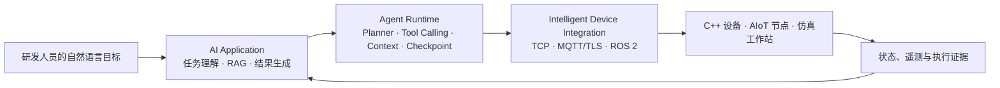

# 岳玉婷 · Yuting Yue

## Industrial AI Applications & Intelligent Systems

工业 AI 应用开发 · Agent 工程化 · 智能设备集成

通信工程本硕背景，具有中国电信物联网研发实习经历。我的工作重点是把大模型、知识检索和任务编排接入设备、云端数据与业务系统，形成能够理解自然语言目标、选择工具、执行多步骤任务并返回可追溯结果的 AI 应用。

`Python` · `LLM / RAG` · `FastAPI` · `Agent Runtime` · `C++17` · `TCP / MQTT / ROS 2` · `PostgreSQL` · `Redis` · `Docker`

### 目标应用产业

| 产业方向 | 关注的 AI 应用 |
|---|---|
| **半导体&AI芯片** | 研发知识助手、设备状态分析、日志诊断、研发工具智能化、Agent 软件平台 |
| **智能汽车** | 车端 Agent、智能终端应用、场景任务执行、智驾研发辅助工具、车云数据接口 |
| **嵌入式AI&机器人技术** | 机器人 Agent、任务编排、技能调用、设备状态查询、ROS 2 接入 |

以上是技术迁移与求职方向；公开仓库验证的是仿真设备、AIoT 节点与 ROS 2 仿真工作站，不声称已完成真实产线、量产车辆或机器人真机部署。

## Core Technology System

- **AI Application：** 自然语言任务理解、工业知识检索、证据关联、诊断解释与业务报告。
- **Agent Runtime：** Planner 接口、工具注册、执行上下文、长任务状态、人工确认与恢复。
- **Intelligent Device Integration：** C++ 设备协议、IoT 端云数据、ROS 2 Topic / Service / Action。

## Core Projects

| 优先级 | 项目 | 软件解决的问题 | 已实现证据 |
|---:|---|---|---|
| 1 | **[Industrial AI Agent](https://github.com/KristenYue/telecom-network-incident-agent)** | 研发人员用自然语言查询设备无法启动原因，Agent 自主选择设备状态与 Runbook 工具并输出处置建议。 | 真实 `qwen3.7-plus` 完成 3 次规划，Runtime 执行 2 次工具调用，C++ 设备返回 `E_STOP`，引用 `sim-interlock-001`；另接入 IoT 遥测与 ROS 2 仿真巡检。 |
| 2 | **[AI Agent Runtime](https://github.com/KristenYue/agent-runtime-quality-platform)** | 为工具型 AI 应用提供可恢复的任务执行引擎。 | Provider-neutral Planner、工具注册、Trace、Checkpoint、人工确认、幂等结果、Lease 与 Fencing。 |
| 3 | **[C++ Device Runtime & SDK](https://github.com/KristenYue/edge-device-verification-lab)** | 为工业 AI 应用提供设备状态机、控制协议和 Python 调用接口。 | C++17 运行时、TCP JSON Lines、联锁、并发服务、缓存与队列超时；4,200 次对照请求全部成功。 |
| 4 | **[AIoT Edge-to-Cloud](https://github.com/KristenYue/smart-supermarket-shelf)** | 两类智能设备采集状态并通过 MQTT/TLS 接入云端，供应用和 Agent 查询。 | 双节点传感器、设备身份、Telemetry v2、固定队列、AWS IoT、DynamoDB 与 Java API；50,000 条合成遥测实验。 |
| 5 | **[NLP & RAG Agent](https://github.com/KristenYue/public-opinion-agent-eval)** | 对中文事件评论进行倾向分析、历史证据检索、选择性复核和人工回写。 | LangGraph、Hybrid RAG、FastAPI、任务状态与审计 Trace；跨事件冻结集上纯自动准确率由 31.27% 提升至 56.05%。 |
| 6 | **[Communication Systems Research](https://github.com/KristenYue/fso-coding-interleaving-simulator)** | 研究自由空间光通信中信道编码、交织深度与相干长度的关系。 | Gamma–Gamma、指向误差、固定相干衰落、RS/LDPC、分组置信区间与独立复现实验链。 |

### Robot Skill Adapter

[Industrial AI Agent 的 ROS 2 扩展](https://github.com/KristenYue/telecom-network-incident-agent/tree/main/ros2/industrial_robot_sim)将仿真工作站封装为 Agent 技能：Topic 发布状态、Service 查询状态、Action 执行 8 个巡检点并反馈进度，支持中途取消。它证明了 Agent Runtime 到机器人任务接口的接入方式，不代表导航、运动控制或真机部署。

## Industrial AI Application Capabilities

| 能力 | 项目落点 |
|---|---|
| 工业知识理解 | 设备 Runbook 与通信故障知识检索，保存知识条目 ID 和版本 |
| AI 任务理解 | 把自然语言研发需求转换为结构化设备目标、诊断和建议 |
| Tool Calling | LLM 根据设备观测选择状态查询和知识检索工具，非法调用失败关闭 |
| 多步骤业务执行 | 后一步依赖前一步结果；任务状态、上下文和工具 Trace 可持久化 |
| 设备与端云接入 | TCP/C++、MQTT/TLS/AWS IoT、ROS 2 Topic/Service/Action |
| 结果生成 | 诊断结论、技术解释、证据引用、安全边界与任务反馈 |

## Background Advantage

- 通信工程训练帮助我理解协议、链路、噪声、编码和系统边界。
- 中国电信物联网研发经历让我关注设备身份、端云接口、状态反馈和可运维性。
- C++ 设备软件与 AIoT 项目提供了模型之外的真实系统接口经验。
- AI Agent 项目将这些能力连接到自然语言任务、知识检索与工具执行。

## Other AI & Communication Work

- [NLP & RAG Agent](https://github.com/KristenYue/public-opinion-agent-eval)：中文情感与风险研判、Hybrid RAG、人机协作。
- [Communication Systems Research](https://github.com/KristenYue/fso-coding-interleaving-simulator)：FSO 信道建模、编码与交织研究。
- [Chinese Sentiment Analysis Thesis](https://github.com/KristenYue/chinese-sentiment-analysis-thesis)：中文文本预处理、XGBoost 与 FastAPI 推理基线。

## Engineering Evidence & Navigation

每个核心项目都区分真实模型、仿真设备、合成数据、宿主机验证和产业应用设想。README 首先解释软件功能，详细测试数量、故障注入和质量门禁集中在各仓库的 `Validation & Limitations` 或 `docs/`。

| 想了解的内容 | 入口 |
|---|---|
| 真实 LLM 输入、工具调用、检索和最终输出 | [Industrial AI Agent live trace](https://github.com/KristenYue/telecom-network-incident-agent/blob/main/docs/industrial-agent-live.json) |
| Agent 执行引擎架构 | [Runtime architecture](https://github.com/KristenYue/agent-runtime-quality-platform/blob/main/docs/ARCHITECTURE.md) |
| C++ 设备协议与运行时 | [Device interface protocol](https://github.com/KristenYue/edge-device-verification-lab/blob/main/docs/INTERFACE_PROTOCOL.md) |
| AIoT 遥测协议 | [Telemetry v2](https://github.com/KristenYue/smart-supermarket-shelf/blob/main/docs/TELEMETRY_V2.md) |
| NLP/RAG 架构与结果 | [Opinion Agent docs](https://github.com/KristenYue/public-opinion-agent-eval/tree/main/docs) |
| 通信仿真实验地图 | [FSO experiment map](https://github.com/KristenYue/fso-coding-interleaving-simulator/blob/main/docs/EXPERIMENT_MAP.md) |
