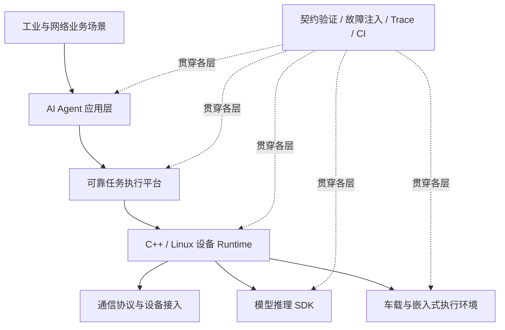

# Hi, I'm Yuting Yue 👋

### 通信与设备系统软件研发｜C++/Linux Runtime｜工业 AI 与可靠任务平台

UCL 通信工程硕士、北京交通大学通信工程学士，预计 2026 年 12 月毕业。  
具有中国电信物联网研发和生产系统 AI 应用经历，关注设备、网络与工业系统中的软件工程问题。

我主要使用 **C++ / Linux / Python** 开发设备 Runtime、模型 SDK、可靠任务平台与可追踪 AI 应用。  
可靠性评测、故障注入、Trace 与 CI 是贯穿项目的工程方法。

---

## 项目之间的关系

这套项目组合覆盖了一条较完整的软件链路：

> 设备与通信接入 → C++ Runtime / SDK → 可靠任务执行 → AI Agent 应用 → 系统验证与可观测性

---

## 不同岗位的项目阅读路径

| 目标方向 | 推荐阅读顺序 | 对应能力 |
|---|---|---|
| **半导体设备软件 / 工业设备平台研发** | [Edge Device Verification Lab](https://github.com/KristenYue/edge-device-verification-lab) → [Smart Supermarket Shelf](https://github.com/KristenYue/smart-supermarket-shelf) → [Industrial Incident Agent](https://github.com/KristenYue/telecom-network-incident-agent) | 设备接入、通信协议、状态管理、模型 SDK、故障诊断 |
| **通信网络软件 / 无线 AI / AIOps** | [Industrial Incident Agent](https://github.com/KristenYue/telecom-network-incident-agent) → [Agent Runtime](https://github.com/KristenYue/agent-runtime-quality-platform) → [FSO Simulator](https://github.com/KristenYue/fso-coding-interleaving-simulator) | 通信背景、网络诊断、任务编排、可靠执行、链路仿真 |
| **AI 芯片 Runtime / SDK / 系统软件** | [Edge Device Verification Lab](https://github.com/KristenYue/edge-device-verification-lab) → [QEMU vECU Runtime](https://github.com/KristenYue/qemu-vehicle-ecu-runtime-lab) → [Agent Runtime](https://github.com/KristenYue/agent-runtime-quality-platform) | C++ SDK、推理接口、异步执行、ARM64、性能与可靠性验证 |
| **工业 AI / Agent 平台研发** | [Industrial Incident Agent](https://github.com/KristenYue/telecom-network-incident-agent) → [Agent Runtime](https://github.com/KristenYue/agent-runtime-quality-platform) → [Edge Device Verification Lab](https://github.com/KristenYue/edge-device-verification-lab) | Tool Calling、任务状态机、可恢复执行、模型与设备集成 |

车载中间件、机器人系统平台和 EDA 工具软件，是上述底层能力可以迁移的应用场景，而不是彼此割裂的项目方向。

---

# 核心项目

## 1. Edge Device Verification Lab

**面向设备平台和 AI Runtime 的 C++/Python SDK 原型。**

项目将设备通信、模型推理、异步任务与质量门禁组织在统一工程结构中，用于验证从接口接入到模型交付的完整链路。

**主要工作：**

- 使用 C++17 实现设备客户端、并发请求与生命周期管理。
- 基于 `pybind11` 向 Python 暴露原生接口。
- 集成 ONNX Runtime，封装 BGE Embedding 推理与异步 Worker。
- 建立 Windows、Ubuntu Wheel 构建及 clean-install 验证流程。
- 对模型精度、延迟、吞吐量和量化退化进行统一验证。

**结果：**

- 完成 **4,200 / 4,200** 次设备请求。
- BGE 输出维度为 `3 × 512`，与 Python ONNX Runtime 的最大绝对误差为 `1.53e-7`。
- 1 / 2 / 4 Worker 异步吞吐量分别达到 **7.79 / 15.05 / 25.89 req/s**。
- 动态 INT8 模型体积缩小 **74.8%**、P50 延迟约提升 **2.66 倍**。
- 同时发现量化后 Recall@1 从 `1.00` 降至 `0.50`，因此将精度回归作为发布门禁，而不是只看性能提升。

**项目优势：**

> 不只完成模型调用，还覆盖 C++ SDK、Python Binding、异步调度、跨平台构建和模型质量门禁。

---

## 2. Agent Runtime Quality Platform

**面向长流程 AI 任务的可靠执行平台。**

项目重点不是 Prompt 展示，而是解决 Agent 任务在超时、重试、进程中断、重复提交和外部服务异常下的执行一致性问题。

**主要工作：**

- 设计任务状态机、Checkpoint、Lease、Fencing Token 和恢复机制。
- 使用 PostgreSQL 保存业务状态，使用 Redis Streams 组织任务消费。
- 实现幂等提交、Outbox、失败关闭与重复执行抑制。
- 建立可回放 Trace、故障注入和冻结契约测试。
- 将 Runtime 接入真实业务 Agent，验证平台与应用的边界。

**结果：**

- **180 / 180** 个冻结功能契约任务通过。
- **70 / 70** 个故障场景符合预期，其中 68 个成功恢复，2 个安全失败关闭。
- 60 次重复提交未产生额外最终写入。
- 完成 PostgreSQL、Redis 真实服务集成验证。

**项目优势：**

> 将 Agent 从一次性脚本提升为具有状态管理、恢复能力、执行边界和可观测性的任务系统。

---

## 3. Telecom Network Incident Agent

**面向网络与工业设备故障的诊断 Agent。**

项目把模型决策、设备工具调用、知识检索和任务状态管理组合为可追踪的诊断流程，并接入 ROS2、SocketCAN 和 ONNX 推理组件。

**主要工作：**

- 实现 Tool Calling、结构化诊断计划和步骤级 Trace。
- 接入 ROS2 逻辑机器人工作站，支持巡检任务和取消控制。
- 使用 Linux SocketCAN / vcan 构建设备诊断链路。
- 集成本地 ONNX 模型和诊断知识检索。
- 对模型输出、工具结果和任务终态进行统一记录。

**结果：**

- 真实模型完成 3 次决策、2 次工具调用和 3 点巡检任务。
- ROS2 规则规划模式完成 **3 / 3** 个巡检点。
- 任务在第 1 个巡检点取消后能够正确进入 `canceled` 状态。
- 本地模型诊断完成 2 次工具调用，并返回可追踪的检索证据。
- SocketCAN 诊断链路识别到左前轮胎压异常：`190 kPa`。

**项目优势：**

> 将通信网络背景、设备接入和 AI Agent 结合起来，重点展示可执行、可取消、可追踪的诊断闭环。

---

## 4. SDV Communication Integration Lab

**面向车载与设备服务的 C++20 通信 Runtime。**

项目围绕服务通信、诊断状态、请求幂等和异常恢复展开，也可迁移至工业设备服务、机器人平台和边缘节点软件。

**主要工作：**

- 使用 C++20 实现车辆服务 Runtime。
- 支持 CAN / SocketCAN 和受控 SOME/IP over UDP 通信。
- 实现 DTC、Freeze Frame、请求幂等、Journal Recovery。
- 处理并发请求协调、Backpressure 和重启恢复。
- 建立协议回放、状态一致性和性能验证矩阵。

**结果：**

- 32 个并发相同状态变更请求中，业务 Handler 只执行 1 次，其余 31 次复用结果。
- 30 次响应丢失与重启重试中，第二次 Handler 执行次数为 0，重复动作数为 0。
- 300 个回放任务和 200 个独立来源场景生成一致摘要。
- 27 组性能矩阵中完成 **3,600 / 3,600** 次调用，最差 P99 为 `389 μs`，最大 RSS 为 `7.58 MiB`。

**项目优势：**

> 不只实现通信接口，还处理重复请求、并发协调、持久化恢复和协议级一致性。

---

## 5. QEMU Vehicle ECU Runtime Lab

**面向 ARM64 嵌入式环境的进程与服务管理 Runtime。**

项目在 QEMU ARM64 环境中实现轻量 Execution Manager，验证服务依赖、健康检查和故障恢复机制。

**主要工作：**

- 使用 `posix_spawnp` 管理子进程生命周期。
- 使用 `epoll`、`signalfd`、`timerfd` 构建事件驱动主循环。
- 通过 Unix Domain Socket 实现 Heartbeat。
- 支持依赖启动、崩溃检测、卡死检测与重启预算。
- 使用 Buildroot 构建可启动 ARM64 系统镜像。

**结果：**

- 在 Buildroot 2026.08.2、Linux 6.18.7、QEMU `virt/Cortex-A53` 环境完成验收。
- 一次 CI 运行中，服务从 `UNHEALTHY` 恢复至 `READY` 用时 `205 ms`。
- 受管理的 SOME/IP 服务恢复至 `READY` 用时 `199 ms`。

**项目优势：**

> 展示从 Linux 系统编程到 ARM64 虚拟环境验收的完整路径，而不局限于上层应用开发。

---

## 6. Smart Supermarket Shelf

**面向 AIoT 设备数据的通信、清洗与异常处理系统。**

项目模拟智能货架设备上报，重点处理网络传输、消息乱序、重复数据和设备身份冲突。

**主要工作：**

- 构建设备遥测数据生成与接收链路。
- 实现 MQTT/TLS 通信和设备身份校验。
- 处理重复消息、乱序数据与身份冲突。
- 记录清洗结果与异常分类。

**结果：**

在 50,000 条合成遥测消息中识别：

- 48,512 条正常消息。
- 1,012 条重复消息。
- 13 条乱序消息。
- 463 条设备身份冲突消息。

**项目优势：**

> 将通信专业背景落到设备协议、消息语义和异常数据处理，而不是停留在单纯的数据分析。

---

# 支撑项目与研究基础

| 项目 | 主要内容 |
|---|---|
| [Public Opinion Agent Evaluation](https://github.com/KristenYue/public-opinion-agent-eval) | 事件感知舆情分类、选择性自动化与 Agent 评测；在 6 个未见事件、339 条评论上验证泛化能力 |
| [FSO Agent Runtime Benchmark](https://github.com/KristenYue/fso-agent-runtime-benchmark) | 对比 LangGraph 与自研 Runtime 的状态、配置、Trace 和本地调度开销 |
| [FSO Coding & Interleaving Simulator](https://github.com/KristenYue/fso-coding-interleaving-simulator) | 自由空间光通信编码、交织与信道仿真，包含独立复现实验和失败案例 |
| [Chinese Sentiment Analysis Thesis](https://github.com/KristenYue/chinese-sentiment-analysis-thesis) | 北京市优秀本科毕业设计，提供公开可复现实验、模型对比和误差分析 |
| [Agent Reliability Evaluation](https://github.com/KristenYue/agent-reliability-eval) | Agent 故障注入、可靠性指标与回归评测 |
| [Airbnb Listing Ranking](https://github.com/KristenYue/airbnb-listing-ranking) | 排序特征、模型评估和数据分析 |
| [Valorant Core QA](https://github.com/KristenYue/valorant-core-qa) | 面向复杂规则系统的自动化验证与缺陷建模 |

---

# 技术栈

### C++ / Linux

- C++17 / C++20
- RAII、智能指针、并发与线程安全
- POSIX Process、Socket、IPC
- `epoll` / `signalfd` / `timerfd`
- CMake、GTest、GitHub Actions

### 设备与通信

- TCP / UDP
- MQTT / TLS
- CAN / SocketCAN
- SOME/IP 子集
- ROS2
- 设备状态与遥测数据处理

### AI 与平台开发

- Python、FastAPI、Pydantic
- PostgreSQL、Redis Streams
- Tool Calling、RAG、Agent Workflow
- ONNX Runtime、pybind11
- 模型量化、性能分析与质量回归

### 可靠性工程

- 状态机与执行契约
- 幂等、Outbox、Checkpoint
- Lease、Fencing Token
- 故障注入与恢复验证
- Trace、Replay、CI 与回归门禁

---

## 工程边界

这些项目主要用于验证软件架构、接口设计和系统可靠性：

- 设备链路包含软件模拟、SocketCAN / vcan 和逻辑机器人环境。
- ARM64 项目基于 QEMU 与 Buildroot，并非真实 ECU 硬件。
- 模型性能数据主要来自 CPU 推理环境。
- README 中的性能结果均对应具体实验环境，不代表生产 SLA 或真实硬件上限。

我更关注的是：**能否把设备、模型和任务系统连接成一个边界清晰、可以恢复、可以验证、可以持续演进的软件系统。**
