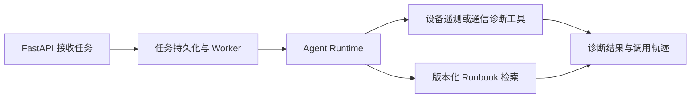

# 岳玉婷 / Yuting Yue

**工业 AI 应用 · Agent Runtime · C++ 设备系统软件**

UCL 通信工程硕士，北京交通大学通信工程本科。曾在中国电信物联网研发部参与 CTWing/AEP 设备管理后端开发与端云联调，涉及遥测回调、设备身份映射、状态查询和下行指令。主要使用 Python、C++17 和 Linux，关注工业设备诊断、任务编排和设备通信软件。

我的项目从同一个研发问题出发：设备上报状态后，软件如何定位异常、执行受控任务，并在断连、超时或重复请求后留下可追踪的结果。

## 核心工程结果

| 工程问题 | 实现与结果 | 可核查证据 |
| --- | --- | --- |
| 如何区分设备急停和通信故障 | 在本机通过 HTTP、SQLite 和 TCP 串联任务系统与仿真设备。正常执行、急停联锁和离线诊断均保留任务结果与工具调用轨迹。 | [设备任务原始轨迹](https://github.com/KristenYue/telecom-network-incident-agent/blob/main/docs/device-api-smoke.jsonl) |
| Worker 重投或接管后，如何保护最终结果 | 共享 Runtime 通过租约、Fencing Token 和幂等账本约束结果提交。独立实验中，**60 组重复任务的额外最终写入为 0**。 | [Runtime 实验与设计](https://github.com/KristenYue/agent-runtime-quality-platform) |
| 慢连接与重复命令如何影响设备运行 | C++ 服务默认 **4 个 Worker、32 个排队位**，应答缓存限制为 **1,024 条**。慢连接场景复现过期拒绝，同机新旧版对照共 **4,200 次请求全部成功**。 | [排队超时结果](https://github.com/KristenYue/edge-device-verification-lab/blob/main/benchmarks/windows-queue-deadline.json) · [对照原始数据](https://github.com/KristenYue/edge-device-verification-lab/blob/main/benchmarks/windows-baseline-comparison.json) |
| 设备重启、重传和乱序如何影响云端数据 | 参考网关复跑 **50,000 条合成输入**，接收 48,512 条，识别 1,012 条重复、13 条乱序和 463 条同身份载荷冲突。 | [遥测契约](https://github.com/KristenYue/smart-supermarket-shelf/blob/main/docs/TELEMETRY_V2.md) · [复现实验](https://github.com/KristenYue/smart-supermarket-shelf/blob/main/iot-test-harness/tools/run_stability.py) |

## 一、工业 AI 应用与可靠任务执行

### [工业设备诊断与任务编排](https://github.com/KristenYue/telecom-network-incident-agent)

通信侧汇总告警、接口状态、路由邻居和指标，检索运行手册并生成诊断与工单草稿。设备侧通过 TCP 适配器读取 C++ 模拟设备，同一套 Runtime 负责调用工具、记录观测并形成可审阅的任务结果。

**核心设计**

- **诊断依据。** 通信和设备场景共用词项检索与故障条件过滤。结果保留设备观测、Runbook ID 和版本，便于回查诊断依据。
- **权限与异常处理。** 诊断工具为只读。模拟写任务需要服务端与请求双重授权。传输失败时记录结果未知，尝试只读查询设备状态，避免盲目重放写操作。
- **任务持久化。** 通信诊断通过 PostgreSQL 事务 Outbox 和 Redis Streams 分发，Worker 将结果落库后再确认消息。设备任务使用 SQL 队列和执行权检查，阻止过期 Worker 覆盖任务状态。

**运行结果。** 本机完成模拟设备归位、校准和任务执行。急停后的启动命令被设备联锁拒绝，诊断引用 `sim-interlock-001`。关闭模拟器后，诊断引用 `sim-transport-001` 并标记转人工处置。公开轨迹来自 HTTP、SQLite 和 TCP 联调，使用仿真设备与确定性编排。

[架构与复现命令](https://github.com/KristenYue/telecom-network-incident-agent/blob/main/docs/INDUSTRIAL_AGENT.md) · [事务与故障窗口](https://github.com/KristenYue/telecom-network-incident-agent/blob/main/docs/DELIVERY_FAILURE_WINDOWS.md)

### [共享 Agent Runtime](https://github.com/KristenYue/agent-runtime-quality-platform)

Runtime 将领域诊断与任务执行机制分离。Checkpoint 保存执行进度，租约和心跳管理执行权，Fencing Token 拒绝旧 Worker 回写，幂等键保护可复用的工具结果与最终提交。Trace 记录工具调用、重试和恢复过程。

Runtime 仓库的独立实验包含 **180/180 个功能场景通过**、**70 个故障场景中 68 个恢复、2 个按设计安全终止**，以及 **60 组重复任务无额外最终写入**。

## 二、C++ 设备系统软件与研发工具

### [边缘设备运行时与控制仿真](https://github.com/KristenYue/edge-device-verification-lab)

用 C++17 实现可接入上位机的设备模拟服务。业务核心处理上电、归位、校准、运行和急停。TCP 入口负责分帧、请求校验、连接资源与并发，Python 客户端用于联调和复现实验。

**核心设计与异常行为**

- **并发幂等。** 在设备互斥锁内检查请求 ID、执行命令并写入应答缓存。相同 ID 和载荷可复用结果，不同载荷复用同一 ID 会返回冲突。幂等重放受缓存容量和进程生命周期约束。
- **连接资源与过载保护。** Socket 通过 RAII 管理。Worker 从有界队列领取连接。队列满时返回 `SERVER_BUSY`，排队超期时返回 `QUEUE_TIMEOUT`，过期命令在设备状态机入口前被拒绝。
- **协议联调。** 使用 JSON Lines 分帧，通过请求 ID 关联应答和结构化事件，可复现半帧慢连接、超时重试和设备联锁。

**对照结果。** 同一台机器上分别测量 `status` 查询与 `start_run` 控制命令，基线和新版各进行三轮。查询 P95 中位数为 **13.79 / 15.04 ms**，控制为 **15.54 / 15.95 ms**（基线 / 新版）。本轮吞吐中位数未提升，已验证的改动效果是缓存有界和排队超期可拒绝。

[架构、代码导航与 Bad Case](https://github.com/KristenYue/edge-device-verification-lab/blob/main/docs/RUNTIME_HARDENING.md) · [基准原始数据](https://github.com/KristenYue/edge-device-verification-lab/blob/main/benchmarks/windows-baseline-comparison.json)

## 三、IoT 设备与端云通信

### [双节点智能货架](https://github.com/KristenYue/smart-supermarket-shelf)

基于 Arduino MKR WiFi 1010 实现环境监测、库存与求助两个节点。固件侧用 C++ 做传感采集、状态判定和本地告警，通过 MQTT/TLS 接入 AWS IoT，Java 服务提供遥测和分析接口。

**核心设计**

- **弱网与资源约束。** 用固定容量 FIFO 缓存离线消息，重连后补发。双节点复用有界退避机制，将采样安排在本轮联网尝试前，宿主机覆盖计时回绕、退避上限和重置。
- **遥测身份。** 用 `deviceID + bootId + sequence` 标识消息，将重启后的新序列与旧会话隔离。参考网关依据身份和载荷区分正常消息、重复、乱序与冲突。
- **配置一致性。** 先校验候选阈值，再一次性提交。设备拒绝重复或旧版本，支持查询生效版本并通过消息回执。
- **接入诊断。** Agent 复用货架云端查询接口取得 MQTT 来源的遥测，检查设备身份和数据新鲜度。适配分支使用合成云端响应验证。

[固件架构与验证范围](https://github.com/KristenYue/smart-supermarket-shelf/blob/main/docs/FIRMWARE_VALIDATION.md) · [遥测 v2 契约](https://github.com/KristenYue/smart-supermarket-shelf/blob/main/docs/TELEMETRY_V2.md)

## 技术能力与阅读路径

| 如果你关注 | 先看 | 可以进一步核查 |
| --- | --- | --- |
| 工业 AI、设备诊断、研发平台 | [工业设备诊断与任务编排](https://github.com/KristenYue/telecom-network-incident-agent) | FastAPI、设备工具、Runbook 检索、权限、异步任务和原始 Trace |
| Agent 执行基础设施 | [共享 Agent Runtime](https://github.com/KristenYue/agent-runtime-quality-platform) | Checkpoint、租约、Fencing Token、幂等提交与接管 |
| C++ 设备软件、通信接口、仿真工具 | [边缘设备运行时](https://github.com/KristenYue/edge-device-verification-lab) | 状态机、TCP 分帧、Socket 生命周期、有界队列和压测 |
| IoT 端云软件 | [双节点智能货架](https://github.com/KristenYue/smart-supermarket-shelf) | MQTT/TLS、设备遥测契约、配置回执和数据一致性 |

## 补充作品

- [自由空间光通信编码与交织仿真](https://github.com/KristenYue/fso-coding-interleaving-simulator) · 硕士毕设代码。使用 Python 在湍流信道下比较 RS、LDPC 与不同交织策略的误码性能和解码开销。
- [中文舆情 Agent](https://github.com/KristenYue/public-opinion-agent-eval) · 展示证据追踪、结构化报告、人工复核与风险控制。
