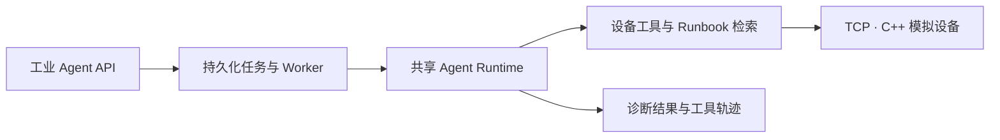

# 岳玉婷 / Yuting Yue

**工业 AI 应用与系统软件研发｜Agent Runtime · C++ 设备控制 · IoT 端云通信**

UCL 通信工程硕士，北京交通大学通信工程本科。曾在中国电信物联网研发部参与 CTWing/AEP 设备管理后端开发与端云联调，涉及遥测回调、设备身份映射、状态查询和下行指令。

主要使用 **Python、C++17 和 Linux**，关注工业设备诊断、可靠任务执行与设备通信软件。主要关注半导体与 AI 芯片企业的工业 AI 应用、设备诊断平台和研发工具，具身智能、汽车智驾、工业AI行业的设备系统软件与端云平台研发。

## 项目主线｜从设备接口到工业 AI 应用

我的项目从设备接入延伸到软件平台。设备端提供可查询的状态和受约束的控制接口，任务平台负责持久化和执行权，诊断应用根据设备状态与运行手册生成可追溯的结果。

- [**C++ 边缘设备运行时**](https://github.com/KristenYue/edge-device-verification-lab)提供设备状态机、TCP 控制接口和联锁，是上位机联调及工业 Agent 设备演示的仿真端。
- [**共享 Agent Runtime**](https://github.com/KristenYue/agent-runtime-quality-platform)提供工具调用、Checkpoint、租约和结果提交保护，由工业诊断应用复用。
- [**工业设备诊断与任务编排**](https://github.com/KristenYue/telecom-network-incident-agent)将设备 TCP 接口、任务执行和知识检索接入同一条业务流程。本机已复现正常执行、急停联锁和设备离线。
- [**双节点智能货架**](https://github.com/KristenYue/smart-supermarket-shelf)提供实体设备接入与 MQTT/TLS 端云通信的证据。工业 Agent 也实现了读取货架云端遥测的适配器，并用合成云端响应验证设备身份、数据新鲜度和诊断分支。

## 核心工程结果

| 工程问题 | 实现与结果 | 可核查证据 |
| --- | --- | --- |
| 如何区分设备联锁与通信失败 | 急停后设备拒绝启动，诊断引用联锁手册。设备离线时，诊断引用通信手册并转人工处置。两条路径均保留工具调用记录。 | [工业 Agent 本机运行轨迹](https://github.com/KristenYue/telecom-network-incident-agent/blob/main/docs/device-api-smoke.jsonl) |
| 重复任务如何保护最终结果 | 共享 Runtime 使用业务唯一键和幂等账本保护提交。**60 组重复任务的额外最终写入为 0**。 | [Runtime 设计与独立实验](https://github.com/KristenYue/agent-runtime-quality-platform) |
| 慢连接和重复命令如何得到约束 | C++ 服务默认 **4 个 Worker、32 个排队位**，应答缓存限制为 **1,024 条**。实测排队超时拒绝。新旧版本对照共 **4,200 次请求全部成功**。 | [排队超时轨迹](https://github.com/KristenYue/edge-device-verification-lab/blob/main/benchmarks/windows-queue-deadline.json) · [对照原始数据](https://github.com/KristenYue/edge-device-verification-lab/blob/main/benchmarks/windows-baseline-comparison.json) |
| 遥测重传、乱序和冲突如何识别 | 参考网关复跑 **50,000 条合成输入**，接收 48,512 条，识别 1,012 条重复、13 条乱序和 463 条同身份载荷冲突。 | [遥测契约](https://github.com/KristenYue/smart-supermarket-shelf/blob/main/docs/TELEMETRY_V2.md) · [可重复实验脚本](https://github.com/KristenYue/smart-supermarket-shelf/blob/main/iot-test-harness/tools/run_stability.py) |

## 一、工业设备诊断与可靠任务执行

### [工业设备诊断与任务编排](https://github.com/KristenYue/telecom-network-incident-agent)

面向设备研发团队的故障定位和受控任务执行。通信侧汇总告警、接口状态、路由邻居和链路指标，形成诊断与工单草稿。设备侧通过 TCP 适配器读取 C++ 模拟设备，在同一个任务记录里保留观测、工具调用和诊断结果。

**核心设计**

- **让诊断依据可回查。** Agent 先通过白名单工具获取状态与故障码，再用故障条件检索版本化 Runbook。结果保留设备观测、Runbook ID 和版本，便于复核诊断是如何得出的。
- **约束写操作和未知结果。** 诊断工具只读。模拟写任务需要服务端开启权限，并由请求显式授权。通信中断后，系统标记结果未知，尝试只读查询设备状态，避免把可能已执行的写命令再发一遍。
- **处理数据库与消息队列之间的故障窗口。** 通信诊断将任务和 Outbox 事件写入同一个 PostgreSQL 事务，由 Worker 发布到 Redis Streams。消费端在结果持久化之后确认消息。设备任务使用 SQL 队列与执行权检查，限制过期 Worker 回写状态。

**运行结果。** 本机使用 FastAPI、SQLite 和 TCP 完成模拟设备归位、校准与运行。急停后再次启动，设备返回 `SAFETY_INTERLOCK`，诊断引用 `sim-interlock-001`。关闭模拟器后，诊断引用 `sim-transport-001`，结果转人工处置。该轨迹使用**仿真设备和确定性编排**，当前真实模型与分布式部署的验收范围详见工程说明。

[架构、模块与复现命令](https://github.com/KristenYue/telecom-network-incident-agent/blob/main/docs/INDUSTRIAL_AGENT.md) · [Outbox 与重投窗口](https://github.com/KristenYue/telecom-network-incident-agent/blob/main/docs/DELIVERY_FAILURE_WINDOWS.md)

### [共享 Agent Runtime](https://github.com/KristenYue/agent-runtime-quality-platform)

将领域逻辑与执行机制分离。**Checkpoint** 保存执行进度，**租约和心跳**决定当前执行权，**Fencing Token** 在写入时拒绝旧 Worker，**幂等键与结果账本**处理重复调用与提交。Trace 用于回看每个工具的输入、结果和恢复过程。

该仓库的独立实验包含 **180/180 个功能场景通过**，**70 个故障场景中 68 个恢复、2 个按设计安全终止**，以及 **60 组重复任务无额外最终写入**。

## 二、C++ 设备系统软件与研发工具

### [边缘设备运行时与控制仿真](https://github.com/KristenYue/edge-device-verification-lab)

在设备与上位机并行开发时，提供一个可独立运行的设备服务，用来联调命令接口、状态流转和异常处理。C++17 业务核心维护上电、归位、校准、运行和急停状态，TCP 服务层负责连接、请求解析和并发，Python 客户端负责联调与复现。

**核心设计**

- **状态机与传输分离。** TCP 入口按 JSON Lines 分帧并校验请求，设备核心统一判断当前状态是否允许执行命令。急停与联锁的判定留在设备侧。
- **让判重、执行和缓存写入保持一致。** 在设备互斥锁内依次查请求 ID、比较请求指纹、执行命令并缓存应答。同 ID 同载荷可复用结果，同 ID 不同载荷返回冲突。缓存为 1,024 条 FIFO，请求驱逐或设备重启后需要重新确认执行状态。
- **为慢连接和排队设置资源边界。** Socket 使用 RAII 管理。等待队列满时返回 `SERVER_BUSY`。连接已入队但等待超期时返回 `QUEUE_TIMEOUT`，命令不会进入设备状态机。请求 ID 串起响应和结构化事件，便于定位故障发生在哪一层。

**对照实验。** 在 Windows x64 Release 环境，以相同负载交替运行基线和当前版本，`status` 与 `start_run` 各做三轮。查询 P95 中位数为 **13.79 / 15.04 ms**，控制命令为 **15.54 / 15.95 ms**（基线 / 当前）。本轮吞吐中位数未提升。已实测的研发成果是缓存有界以及慢连接场景下可拒绝过期任务。

[架构、关键源码与 Bad Case](https://github.com/KristenYue/edge-device-verification-lab/blob/main/docs/RUNTIME_HARDENING.md) · [基准原始数据](https://github.com/KristenYue/edge-device-verification-lab/blob/main/benchmarks/windows-baseline-comparison.json)

## 三、IoT 设备与端云通信

### [双节点智能货架](https://github.com/KristenYue/smart-supermarket-shelf)

基于 Arduino MKR WiFi 1010 实现环境监测、库存与求助两个节点。设备端负责采集、状态判断和本地告警，使用 MQTT/TLS 接入 AWS IoT，Java 服务提供查询和分析接口。项目重点处理断网后的数据补发、设备重启后的消息身份，以及远程配置的一致性。

**核心设计**

- **把采样安排在联网尝试前。** 双节点共用有界重连退避。联网失败时保留本地采样和告警路径，固定容量 FIFO 缓存离线消息。宿主机覆盖计时回绕、退避上限和成功重置。
- **用设备身份和会话序号判断消息。** `deviceID + bootId + sequence` 将不同启动会话隔离。参考网关同时比较消息身份和载荷，区分重复上报、乱序和同身份载荷冲突。
- **让配置应用可查询。** 阈值参数先在候选配置上校验，通过后一次性提交。设备拒绝重复或旧版本，并通过回执暴露当前生效版本。配置版本在当前设备运行会话内维护。
- **将遥测作为只读诊断输入。** 工业 Agent 复用已有云端查询接口读取 MQTT 来源的遥测。适配层校验设备身份和服务端接收时间，遇到过期数据时返回遥测不可用。

[固件架构、配置版本与验证范围](https://github.com/KristenYue/smart-supermarket-shelf/blob/main/docs/FIRMWARE_VALIDATION.md) · [遥测 v2 协议](https://github.com/KristenYue/smart-supermarket-shelf/blob/main/docs/TELEMETRY_V2.md)

## 阅读导览

| 如果你关注 | 我的亮点技术 | 建议先看 |
| --- | --- | --- |
| **半导体 / AI 芯片 · 工业 AI 应用、诊断平台、研发工具** | 接入设备观测，检索诊断知识，管理工具权限和任务执行，输出可追踪的诊断结果。 | [工业 Agent 架构与复现](https://github.com/KristenYue/telecom-network-incident-agent/blob/main/docs/INDUSTRIAL_AGENT.md) |
| **半导体设备 / 工业设备 · 设备控制软件、上位机、仿真工具** | 建模设备状态，开发通信接口，处理命令幂等、连接资源与过载。 | [C++ 设备运行时](https://github.com/KristenYue/edge-device-verification-lab) |
| **智能终端 / 汽车软件 · Agent 应用与任务运行时** | 实现受控工具调用、进度持久化、执行权管理和故障恢复。 | [共享 Agent Runtime](https://github.com/KristenYue/agent-runtime-quality-platform) |
| **通信 / 工业 IoT · 设备平台、端云接口与遥测服务** | 开发设备上报、配置下发和查询接口，处理弱网、重复消息和重启后的序列隔离。 | [双节点智能货架](https://github.com/KristenYue/smart-supermarket-shelf) |

## 补充作品

- [自由空间光通信编码与交织仿真](https://github.com/KristenYue/fso-coding-interleaving-simulator) · 硕士毕设代码。基于 Python 建模复杂信道空间下光通信链路的湍流信道，对比 RS、LDPC 与交织策略对误码性能和解码开销的影响。
- [中文舆情 Agent](https://github.com/KristenYue/public-opinion-agent-eval) 基于本科机器学习毕业设计（北京交通大学优秀毕业设计）搭建的agent platform。· 展示证据追踪、结构化报告、人工复核与风险控制。
